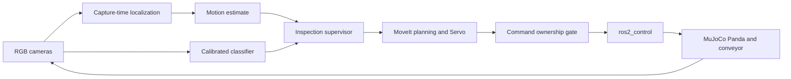

# Conveyor Sorting with Active Inspection

A ROS 2 and MuJoCo simulation in which a Franka Panda sorts fruit-bearing trays from a moving conveyor.
The system combines camera tracking, confidence-based inspection, predictive interception and physical tray handling.

**Stack:** C++ · Python · ROS 2 Jazzy · MuJoCo · MoveIt 2 · ros2_control

## Capabilities

- Track the tray handle from overhead and wrist RGB images using capture-time transforms.
- Estimate target motion and predict the interception position.
- Use calibrated class confidence to select a bin, request another view or let a tray pass.
- Plan collision-aware arm movements and use Cartesian Servo for approach and alignment.
- Grip, lift and place the tray through physical finger contact.
- Enforce exclusive ownership of planned, Servo and hold commands.
- Check contact forces, tray slip, reset state, timestamps and evaluator isolation.

## System architecture

## Recorded simulation results

| Evaluation | Recorded result |
| --- | --- |
| Static grasp, lift and reset | 20 / 20 cycles |
| Moving grasp with oracle target input | 20 / 20 trials |
| Camera-driven moving pickup | 19 / 20 trials |
| Classified fixed-view sorting | 20 / 20 nominal sorts across two bins |
| Covered-fruit rejection | Both class fixtures passed |
| Stationary active inspection | All six clear, partial and covered fixtures passed |

These results apply to the documented synthetic scenes and operating conditions.
The classifier distinguishes synthetic red and green cues.
It does not yet recognize real fruit types.
Integrated autonomous inspection and pickup, broader timing qualification and held-out stress evaluation remain in development.

## Getting started

1. Follow [Setup](docs/SETUP.md) to install dependencies and build the workspace.
2. Follow [Running](docs/RUNNING.md) to launch the viewer and run the supported workflows.
3. Read [Validation](docs/VALIDATION.md) for test commands and evaluation scope.

## Code map

| Package | Responsibility |
| --- | --- |
| `sorting_description` | Panda model, tray, handle, bins and camera descriptions |
| `sorting_interfaces` | Project messages and services |
| `sorting_simulation` | Physics, conveyor transport, contact sensing and reset |
| `sorting_control` | Planning, Servo, interception and command ownership |
| `sorting_perception` | Localization, filtering and calibrated classification |
| `sorting_supervisor` | Inspection execution, confidence policy and deadline checks |

See [Architecture](docs/ARCHITECTURE.md) and [Project scope](PROJECT_PLAN.md) for design details.
The repository contains the current implementation, model assets and automated tests.
Generated datasets, execution logs and local development archives are excluded.

## License

Project code uses [Apache-2.0](LICENSE).
Robot assets retain their supplied model licenses.
Maintainer: [SahilRMane](https://github.com/SahilRMane).
